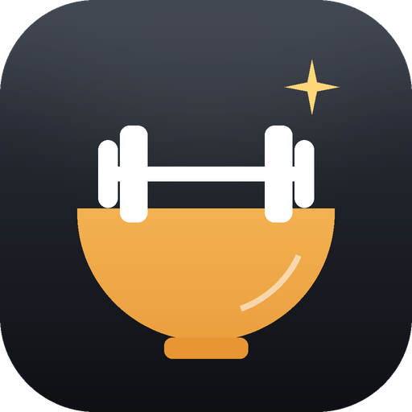
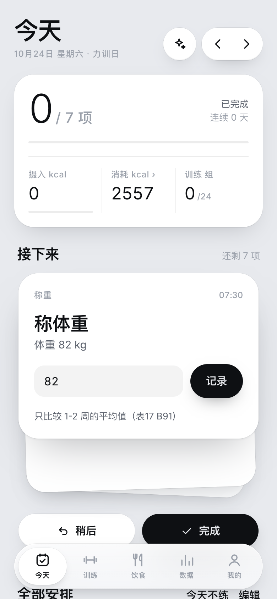
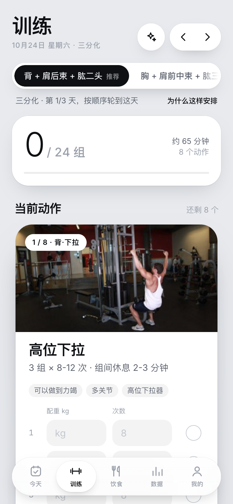
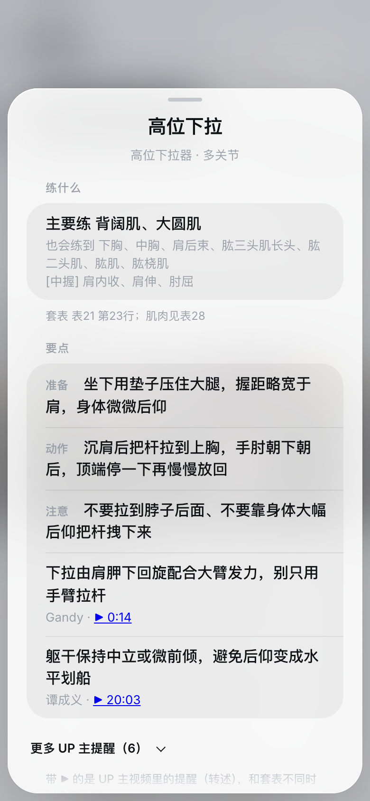
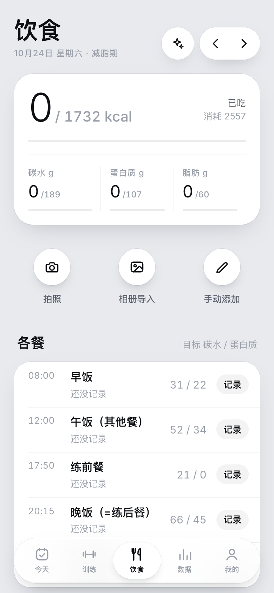
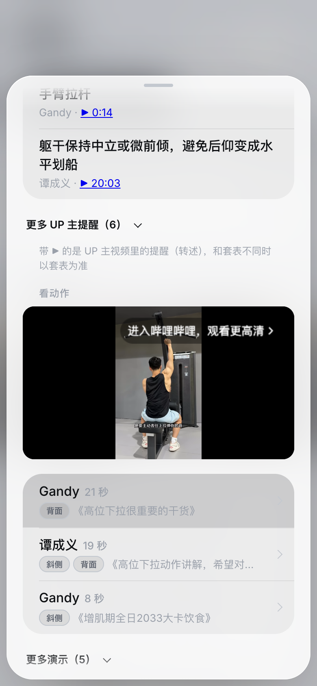
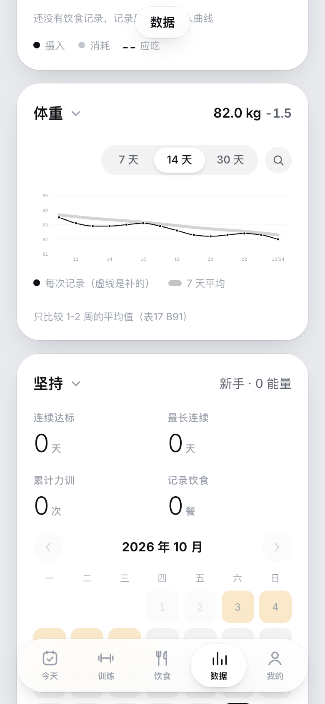
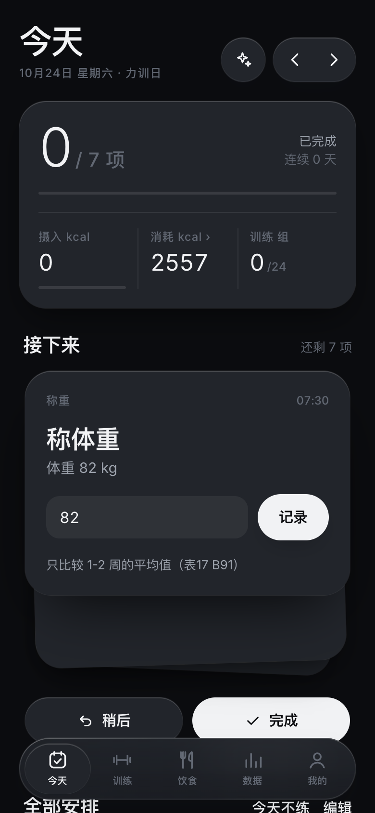

<h1 align="center">练好吃对</h1>

按《健身Excel超级套表》（B站 好人松松）算好你每天吃什么、练什么， 再一项项打勾完成。

<a href="https://github.com/ABigCyan/lianchi-daily/releases/latest"><b>下载安卓版</b></a> · 免费 · 不用注册 · 数据只存在你手机上

## 它和别的健身 App 有什么不一样

**每个数字都有出处。** 吃多少碳水、练几组、休息多久，都按《健身Excel超级套表》算，旁边标着原表的表号和行号，点开就能看原文。原表没写、App 自己补的地方，都明确标成“应用补充”。

**打开就知道今天干什么。** 不用自己排计划：
- 填一次身高、体重、几点练、几点吃饭，App 就判断你该减脂还是增肌；
- 算出每天的热量和每餐吃多少；
- 选好分化和动作；
- 每天排成一张时间线：几点称重、几点吃哪顿、几点练什么，到点提醒。

**练的时候有人教。**
- 每个动作都有“要点”：先说练哪里，再给准备、动作、注意三句话，加上 B站 UP 主的提醒。
- 想看动作，点一下就在 App 里播放 UP 主本人在器械上的演示，从那一秒开始放，正面、侧面都标好了。
- 演示片段一段段人工看过，对不上的一律不放。

## 主要功能

| | |
|---|---|
| 🗓 **今天** | 一张时间线，完成一项打一个勾。凌晨 4 点才换下一天，熬夜不会被算到第二天 |
| 🏋️ **训练** | 动作、组数、次数都来自原表；能换成同一肌群的其他动作；每组记重量和次数，下次自动建议加不加重 |
| 📖 **动作要点** | 练什么、怎么做、UP 主提醒、在 App 里直接看演示 |
| 🍚 **饮食** | 拍照识别热量（可以附一句“米饭只吃了一半”），也能从表19 的食物里选，或者说一句话让 AI 记 |
| 📈 **数据** | 体重趋势（看一周平均，不看单天）、摄入和消耗、打卡日历 |
| 💬 **助手** | 问问题，它先查原表、再查补充资料和 UP 主经验，回答标出处；也能帮你改计划、记饮食，改之前都会先问你 |
| 🧠 **记得你** | 伤病、器械、作息、忌口，说一次助手就记住，以后回答都会考虑，记错了可以改 |
| 🌙 **好看** | 浅色、深色，多种主题色和卡片风格 |

## 大模型（可选）

不接大模型也能用：计划、时间线、训练记录、数据都在本机算。想用拍照识别和助手，可以接入你自己的大模型账号：

- 支持通义千问、智谱、豆包、Kimi、**MiniMax**、**DeepSeek**、OpenAI、Claude，或任何 OpenAI 兼容接口；
- 填好 Key 后自动扫描能用的模型；
- 新手引导里可以打开“让 AI 按我的情况调整计划”，设置完助手会帮你把计划检查一遍；
- 没网也能用：可以下载一个约 1.2GB 的内置小模型，离线回答套表里的问题。

API Key 只保存在你的手机上。

## 安装

到 [Releases](https://github.com/ABigCyan/lianchi-daily/releases/latest) 下载 `lianchi-daily-<版本号>.apk`，在安卓手机上打开安装，需要允许“安装未知来源应用”。以后有新版本，App 里会提示，点一下就能更新，数据不会丢。

## 内容来源

- **饮食和训练规则**：《健身Excel超级套表》，作者 B站 好人松松（文件注明“可任意分享”）。仓库里不含原表文件，只有整理出的文字，每条都带表号和行号。
- **UP 主干货和演示**：好人松松、Gandy、东哥（烧毁一切就是美）、谭成义在 B站 公开的讲解视频。要点是转述，不是原话；演示用 B站 官方播放器播放，视频没有转存，版权归 UP 主。和套表不同时以套表为准。
- **补充资料**：WHO、ACSM、中国人群身体活动指南、NSCA 教材和高引用研究的共识，只摘结论并注明出处。默认按套表，补充资料只在套表没写，或你主动选用时出现。
- **动作图片**：[free-exercise-db](https://github.com/yuhonas/free-exercise-db)（公有领域）。
- **节假日**：[holiday-cn](https://github.com/NateScarlet/holiday-cn)。
- **字体和框架**：[Inter](https://rsms.me/inter/)（SIL OFL 1.1）、[Capacitor](https://capacitorjs.com)（MIT）。

本应用是个人学习工具，不能代替医生建议；有伤病请先问医生。

---

想参与开发、自己编译，或者了解算法细节：[开发与发布](docs/DEVELOP.md) · [算法和出处](ALGORITHM.md) · [界面设计](DESIGN.md) · [更新记录](CHANGELOG.md)
